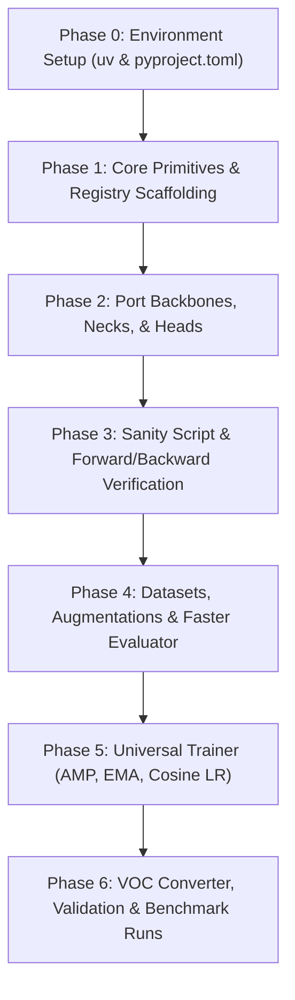

# LucidDet Architecture & Consolidation Plan
**Unified Modern Object Detection Framework**

---

## 1. Executive Summary & Objective

The goal of this project is to consolidate three separate object detection codebases in `/mnt/ken/proj/vision_lib`:
1. `YoloV1/` (Darknet-24, FC head, VOC from-scratch baseline)
2. `yolo_x/` (CSPDarknet, PAFPN, Decoupled Head, SimOTA, trained on VOC)
3. `lucid_det/trial_1/` (CSPNeXt, CSPNeXtPAFPN, SepBNHead, QFL/GIoU)

into a single, clean, modular detection library named **LucidDet**, architected with a clean, modular design philosophy.

### Core Philosophy
* **Zero OpenMMLab Bloat:** No `mmcv` compilation headaches, no `mmengine` runner abstractions, no nested `_base_` YAML/Python config mazes.
* **Pure PyTorch & Readability:** Clean, explicit PyTorch code you can step through line-by-line with a standard debugger (`pdb` / VSCode).
* **Modern Tooling:** Managed via `uv` and `pyproject.toml` for fast, reproducible dependency resolution.
* **Component-First Modularity:** Swappable Backbones, Necks, Heads, Assigners, and Losses via lightweight dictionary registries and dependency injection.
* **Unified Training & Evaluation Loop:** One unified training engine supporting AMP (`torch.amp`), `ModelEMA`, Linear Warmup + Cosine Annealing, and fast COCO mAP evaluation via `faster-coco-eval`.

---

## 2. Source Asset Inventory

| Project | Location | Key Assets to Harvest | Current Status |
| :--- | :--- | :--- | :--- |
| **YoloV1** | `/mnt/ken/proj/vision_lib/YoloV1` | • `model.py` (Darknet-24 backbone & FC head)<br>• `loss.py` (YOLOv1 coordinate/confidence/class loss)<br>• `dataset.py` (Pascal VOC parser) | Complete baseline |
| **yolo_x** | `/mnt/ken/proj/vision_lib/yolo_x` | • `model.py` (CSPDarknet backbone & PAFPN neck)<br>• `loss.py` & `utils.py` (SimOTA matcher, IoU math)<br>• `data.py` (Mosaic, MixUp, Letterbox augments) | Complete (mAP 0.2819) |
| **lucid_det (trial_1)** | `/mnt/ken/proj/vision_lib/lucid_det/trial_1` | • `model/backbones/cspnext.py` (CSPNeXt with depthwise convs)<br>• `model/necks/pafpn.py` (CSPNeXtPAFPN)<br>• `model/head/sep_bn_head.py` (Decoupled SepBNHead)<br>• `model/losses/` (Quality Focal Loss, GIoU) | Forward pass verified |

---

## 3. Unified Architecture & Component Mapping

Each detector in LucidDet adheres to the single-stage contract:
$$\text{Input Image} \xrightarrow{} \text{Backbone} \xrightarrow{\{P_3, P_4, P_5\}} \text{Neck} \xrightarrow{\{F_3, F_4, F_5\}} \text{Head} \xrightarrow{} (\text{Cls Scores}, \text{Bbox Reg})$$

Target assignment and loss computation are strictly decoupled from the forward pass:

```
                          ┌───────────────────────┐
                          │      Input Batch      │
                          └───────────┬───────────┘
                                      │
                                      ▼
                        ┌───────────────────────────┐
                        │    SingleStageDetector    │
                        │ ┌───────────────────────┐ │
                        │ │  Backbone (CSP/Dark)  │ │
                        │ └───────────┬───────────┘ │
                        │             ▼             │
                        │ │  Neck (PAFPN/Identity)│ │
                        │ └───────────┬───────────┘ │
                        │             ▼             │
                        │ │  Head (SepBN/Decoupled│ │
                        │ └───────────────────────┘ │
                        └─────────────┬─────────────┘
                                      │ Predictions (cls_scores, bbox_preds)
                 ┌────────────────────┴────────────────────┐
                 │                                         │
        [Training Mode]                            [Inference Mode]
                 │                                         │
                 ▼                                         ▼
   ┌───────────────────────────┐             ┌───────────────────────────┐
   │    Assigner (e.g. SimOTA) │             │    Box Decoder & NMS      │
   │  - Matches GT to priors   │             │  - Converts deltas to xyxy│
   └─────────────┬─────────────┘             │  - Batched torchvision NMS│
                 ▼                           └─────────────┬─────────────┘
   ┌───────────────────────────┐                           ▼
   │       Loss Modules        │                    Final Detections
   │  - Classification (QFL)   │
   │  - Regression (GIoU/CIoU) │
   └───────────────────────────┘
```

### Component Registry Matrix

| Component Type | Module Name | Implementation Source | Notes |
| :--- | :--- | :--- | :--- |
| **Backbones** | `darknet24` | `YoloV1/model.py` | 24 conv layers + LeakyReLU for VOC baseline |
| | `cspdarknet` | `yolo_x/model.py` | Focus stem + CSP blocks (tiny, s, m, l, x) |
| | `cspnext` | `lucid_det/trial_1` | Large 5x5 depthwise separable convs + channel attention |
| **Necks** | `identity` | Built-in | Passthrough neck for single-scale heads (YOLOv1) |
| | `yolox_pafpn` | `yolo_x/model.py` | Top-down FPN + Bottom-up PANet |
| | `cspnext_pafpn` | `lucid_det/trial_1` | PAFPN with CSPNeXt blocks and depthwise convolutions |
| **Heads** | `yolov1_head` | `YoloV1/model.py` | Flatten + Linear(1024*S*S, 496) -> Linear(496, S*S*30) |
| | `yolox_head` | `yolo_x/model.py` | Decoupled 2-branch convs (Cls + Reg + Objectness) |
| | `sep_bn_head` | `lucid_det/trial_1` | Decoupled head with shared convs & level-separated BN |
| **Assigners** | `grid_assigner` | `YoloV1/loss.py` | Hard SxS grid cell assignment |
| | `simota` | `yolo_x/loss.py` | Dynamic top-k optimal transport assignment |
| **Losses** | `yolov1_loss` | `YoloV1/loss.py` | Multi-task SSE with coordinate/confidence weighting |
| | `qfl` | `lucid_det/trial_1` | Quality Focal Loss with soft IoU targets |
| | `giou` / `ciou` | `yolo_x/loss.py` | Vectorized bounding box IoU losses |

---

## 4. Target Directory Structure (`lucid_det/`)

```text
lucid_det/
├── .gitignore
├── pyproject.toml              # uv packaging & pinned dependencies
├── README.md                   # Quickstart, benchmarks & model zoo table
├── docs/                       # Architectural docs & user guides
│   ├── plan.md                 # This consolidation blueprint
│   └── custom_components.md    # Guide: Adding new backbones/losses
│
├── luciddet/
│   ├── __init__.py
│   ├── core/                   # Mathematical & geometry primitives
│   │   ├── __init__.py
│   │   ├── box_coder.py        # cxcywh <-> xyxy, grid priors generation
│   │   ├── iou.py              # IoU, GIoU, CIoU computation
│   │   └── nms.py              # Batched multi-class NMS
│   │
│   ├── backbones/              # Swappable feature extractors
│   │   ├── __init__.py         # BACKBONES registry + build_backbone()
│   │   ├── common.py           # ConvBN-SiLU, DepthwiseSeparableConv, ChannelAttention
│   │   ├── darknet24.py        # YOLOv1 Darknet-24
│   │   ├── cspdarknet.py       # YOLOX CSPDarknet
│   │   └── cspnext.py          # RTMDet CSPNeXt
│   │
│   ├── necks/                  # Multi-scale feature aggregators
│   │   ├── __init__.py         # NECKS registry + build_neck()
│   │   ├── identity.py         # Pass-through for single-scale detectors
│   │   ├── pafpn.py            # YOLOX PAFPN
│   │   └── cspnext_pafpn.py    # CSPNeXt PAFPN
│   │
│   ├── heads/                  # Prediction heads
│   │   ├── __init__.py         # HEADS registry + build_head()
│   │   ├── yolov1_head.py      # FC head for YOLOv1
│   │   ├── yolox_head.py       # Decoupled Conv head
│   │   └── sep_bn_head.py      # Shared Conv + SepBN head (RTMDet)
│   │
│   ├── assigners/              # Ground-truth to anchor/prior matchers
│   │   ├── __init__.py         # ASSIGNERS registry + build_assigner()
│   │   ├── grid_assigner.py    # YOLOv1 grid matcher
│   │   └── simota.py           # SimOTA / Dynamic Soft Label Assigner
│   │
│   ├── losses/                 # Modular loss functions
│   │   ├── __init__.py         # CLS & BOX loss registries
│   │   ├── det_loss.py         # Combined multi-task loss dispatcher
│   │   ├── qfl_loss.py         # Quality Focal Loss
│   │   ├── iou_loss.py         # IoU / GIoU / CIoU loss modules
│   │   └── yolov1_loss.py      # YOLOv1 custom SSE loss
│   │
│   ├── datasets/               # Data loaders & augmentations
│   │   ├── __init__.py
│   │   ├── coco.py             # COCO-format detection dataset
│   │   ├── transforms.py       # Letterbox, Mosaic, MixUp, RandomAffine, HSV
│   │   └── collate.py          # Variable-size batch collate functions
│   │
│   ├── engine/                 # Training & evaluation machinery
│   │   ├── __init__.py
│   │   ├── evaluator.py        # faster-coco-eval with pycocotools fallback
│   │   ├── ema.py              # ModelEMA (Exponential Moving Average)
│   │   └── lr_scheduler.py     # Linear Warmup + Cosine Annealing
│   │
│   ├── models/                 # Assembled detector classes
│   │   ├── __init__.py
│   │   ├── detector.py         # SingleStageDetector base class
│   │   └── zoo.py              # Pre-wired model builders:
│   │                           # - build_yolov1()
│   │                           # - build_yolox(scale='s'|'m'|'l')
│   │                           # - build_rtmdet(scale='tiny'|'s'|'m')
│
├── runners/                    # Full training execution runners
│   ├── __init__.py
│   └── det_runner.py           # Epoch loop, validation cadence, EMA sync, checkpointing
│
├── training_scripts/           # Production experiment configs & entrypoints
│   └── det/
│       ├── __init__.py
│       ├── config.py           # Dataclass configs (TrainConfig, OptimConfig, etc.)
│       └── train.py            # Production training launcher (MLflow, logging, runner hook)
│
├── train.sh                    # Shell launcher with uv run & CUDA/cuDNN environment setup
│
├── tools/                      # Executable CLI entry points
│   ├── sanity.py               # Forward & backward pass sanity checks
│   ├── make_dummy_data.py      # Creates synthetic tiny COCO dataset for quick checks
│   ├── convert_voc_to_coco.py  # Converts Pascal VOC XML annotations to COCO JSON
│   ├── train_det.py            # Lightweight argument-driven training CLI
│   ├── eval.py                 # Standalone mAP evaluation script
│   └── infer.py                # Image/directory visualization and inference
│
└── tests/                      # Automated unit tests
    ├── test_backbones.py
    ├── test_necks.py
    ├── test_heads.py
    └── test_losses.py
```

---

## 5. Phased Implementation Roadmap



### Phase 0: Environment & Project Scaffolding
* Initialize `uv` project inside `lucid_det/`.
* Configure `pyproject.toml` with dependencies:
  * `torch`, `torchvision`, `numpy`, `opencv-python`
  * `faster-coco-eval`, `pycocotools`, `tqdm`
  * `albumentations`, `matplotlib`
* Create clean package directory layout.
* Promote files out of `lucid_det/trial_1/` into proper package modules.

### Phase 1: Core Primitives & Registry Infrastructure
* Port `core/box_coder.py`, `core/iou.py`, and `core/nms.py`.
* Implement lightweight dictionary registries:
  * `BACKBONES` in `luciddet/backbones/__init__.py`
  * `NECKS` in `luciddet/necks/__init__.py`
  * `HEADS` in `luciddet/heads/__init__.py`
  * `CLS_LOSS` & `BOX_LOSS` in `luciddet/losses/__init__.py`
  * `ASSIGNERS` in `luciddet/assigners/__init__.py`

### Phase 2: Harvest & Adapt Components
* **Backbones:**
  * Port `CSPNeXt` from `lucid_det/trial_1`.
  * Port `CSPDarknet` from `yolo_x/model.py`.
  * Port `Darknet24` from `YoloV1/model.py`.
  * Guarantee standard interface: `.forward(x)` returns a list of feature maps `[P3, P4, P5]` with standardized `.out_channels` and `.strides` attributes.
* **Necks:**
  * Port `PAFPN` (YOLOX) and `CSPNeXtPAFPN` (RTMDet).
  * Implement `IdentityNeck` for YOLOv1.
* **Heads:**
  * Port `SepBNHead` (RTMDet) with decoupled classification/regression paths.
  * Port `YOLOXHead` (Decoupled Conv head).
  * Port `YOLOv1Head` (Flatten + Linear).
* **Assigners & Losses:**
  * Port `SimOTA` from `yolo_x/loss.py`.
  * Port `QFLoss` and `GIoULoss` / `CIoULoss`.
  * Port YOLOv1 multi-task loss.

### Phase 3: Sanity Verification (`tools/sanity.py`)
* Create `tools/sanity.py`.
* Construct instances of:
  1. `build_yolov1(num_classes=20)`
  2. `build_yolox(scale='s', num_classes=80)`
  3. `build_rtmdet(scale='tiny', num_classes=80)`
* Verify that a dummy batch `(2, 3, 640, 640)` executes:
  * Forward pass without errors.
  * Backward pass (`loss.backward()`) without gradient breakage.
  * Inference decoding with NMS returns valid box tensors.

### Phase 4: Datasets, Augmentations & Fast Evaluation
* Implement `luciddet/datasets/coco.py` reading standard COCO JSON format.
* Port augmentations from `yolo_x/data.py` (Letterbox resize, horizontal flip, HSV jitter, Mosaic, Mixup).
* Implement `tools/convert_voc_to_coco.py` to allow Pascal VOC datasets to run seamlessly through the COCO pipeline.
* Implement `luciddet/engine/evaluator.py` using `faster-coco-eval` with automatic fallback to `pycocotools`.

### Phase 5: Universal Trainer Engine (`tools/train.py`)
* Write `tools/train.py` using a transparent, self-contained PyTorch loop:
  * Mixed precision via `torch.amp.autocast("cuda")` and `torch.amp.GradScaler("cuda")`.
  * Model exponential moving average via `ModelEMA`.
  * Param-group weight decay separation (no weight decay on 1D bias and norm weights).
  * Linear warmup for first $N$ steps, followed by Cosine Annealing learning rate schedule.
  * Periodic validation against `faster-coco-eval` logging $mAP_{50:95}$ and $mAP_{50}$.
  * Best checkpoint saving (`checkpoints/<exp_name>/best.pth` and `last.pth`).

### Phase 6: Validation & Benchmark Reproduction
* Run 2-epoch dummy dataset test (`tools/make_dummy_data.py`) to confirm training mechanics end-to-end.
* Train YOLOX and RTMDet-tiny on Pascal VOC (converted to COCO format) to verify parity with previous standalone training results (e.g. YOLOX mAP ~0.28).

---

## 6. Verification Criteria & Milestones

| Milestone | Checkpoint Command | Expected Result |
| :--- | :--- | :--- |
| **M1: Environment** | `uv sync` | Clean virtualenv built from `pyproject.toml` with zero build failures. |
| **M2: Forward/Backward Sanity** | `uv run tools/sanity.py` | All 3 model configurations pass forward, loss assignment, backward, and NMS decoding. |
| **M3: Fast Pipeline Check** | `uv run tools/make_dummy_data.py`<br>`uv run tools/train.py --dummy --epochs 2` | 2 full epochs train and validate on dummy data with AMP and EMA without NaN loss. |
| **M4: VOC Parity Training** | `uv run tools/train.py --model yolox_s --data data/voc_coco/ --epochs 10` | Loss steadily decreases; validation mAP begins tracking upward. |
| **M5: Inference Visualizer** | `uv run tools/infer.py --img sample.jpg --weights checkpoints/best.pth` | Bounding boxes and labels correctly rendered and saved to `outputs/vis.jpg`. |

---

## 7. Next Actions & Discussion Points

Before execution begins, please review these architectural choices:
1. **Packaging:** Are you happy using `uv` with `pyproject.toml` (standard modern practice)?
2. **Annotation Format:** Standardizing on COCO JSON internally with an automated Pascal VOC $\to$ COCO converter script.
3. **Execution Sequence:** Ready to proceed with Phase 0 & Phase 1 (setting up `pyproject.toml` and directory skeleton)?
